# Playground

The weather demo at `/agent` works without an API key. The separate coder demo
at `/coder` runs commands in sandpiper microVMs. It requires authenticated access and isolates caller state.

## Coder architecture

```mermaid
flowchart LR
  subgraph browser["Browser"]
    page["/coder page<br/>&lt;run-output&gt; (server-rendered, then hydrated)"]
  end
  mcpc["MCP client"]

  subgraph server["Playground server (Node.js)"]
    direction TB
    login["POST /api/coder/session<br/>credential → signed session ID + cookie"]
    route["Chat route<br/>/__litro/agent/coder/:session"]
    mcp["MCP route<br/>/__litro/mcp/coder"]
    guard["Access guard<br/>coder-auth.ts"]
    agent["Coder agent<br/>scripted or LLM"]
    store[("Coder history<br/>bounded logs")]
    tool["run-code tool<br/>argv only, 10 s timeout"]
    bind["Machine bindings<br/>machines.ts<br/>principal + agent + session + transport<br/>live and rate limits"]
    client["sandpiper client<br/>vendor/sandpiper"]
    route --> guard --> agent --> tool
    agent --- store
    mcp --> guard2["Access guard"] --> tool
    tool --> bind --> client
  end

  subgraph host["Linux KVM host (Lima VM on a Mac)<br/>sandboxed mode: root, SANDPIPER_UNSANDBOXED unset"]
    direction TB
    daemon["sandpiperd<br/>API · event log · cgroups<br/>wall check · nftables"]
    subgraph jail["Per machine: sandboxed VMM"]
      vmm["VMM process<br/>own uid · namespaces · seccomp<br/>relay decodes guest frames"]
    end
    subgraph vm["microVM (node template)"]
      guest["guest agent<br/>vsock"]
      work["workload command<br/>uid 1000 · no network device"]
    end
    daemon -->|"spawns, limits, kills"| vmm
    vmm -->|vsock| guest --> work
  end

  page -->|sign in| login
  page -->|run| route
  mcpc --> mcp
  client -->|"HTTP + SANDPIPER_TOKEN<br/>127.0.0.1:7171"| daemon
```



- **Who may run code:** only callers with a coder credential. The guard runs
  on the chat and MCP routes. Session IDs are signed and bound to the
  credential's principal, so another principal cannot use them. Everyone who
  shares one credential (`CODER_ACCESS_TOKEN`) shares one principal; use
  `CODER_ACCESS_TOKENS` for separate people.
- **Which machine:** a chat session keeps one machine per principal and
  session. MCP calls the tool directly, without the agent loop or chat
  history: each MCP `run-code` call gets a fresh machine. The tool attempts to
  destroy it when the underlying execution settles, which can be after an MCP
  timeout response. If that destroy fails, the machine stays counted against
  the limits until sandpiperd removes it.
- **What stays on the server:** `SANDPIPER_URL` and `SANDPIPER_TOKEN`. They
  never reach the browser, the model or the machine.
- **What comes back:** sandpiper keeps the first 1 MiB of each stream. Of that
  captured output, the model gets the last 8000 / 4000 characters of stdout /
  stderr, and the page gets at most the last 64 KiB per stream, rendered as
  text. So a very noisy command's final lines may not come back.
- **The walls, when sandpiperd runs sandboxed** (on Linux, as root, with
  `SANDPIPER_UNSANDBOXED` unset): workload commands run as an unprivileged
  user with no network device; the VMM runs in its own sandbox; and
  sandpiperd checks every machine's walls before it hands the machine out.
  The playground does not check which mode the daemon runs in. An unsandboxed
  daemon is for development only: it skips the host-side VMM sandbox, cgroups,
  firewall setup and wall checks. The guest-side limits stay: workload
  commands still run as uid 1000 under the guest's seccomp filter, with no
  network device.

## Run code

Use Node.js 22.12 or later and pnpm. From the repository root:

```sh
pnpm install --frozen-lockfile
pnpm --filter @beatzball/litro-router build
pnpm --filter @beatzball/litro build
pnpm --filter @beatzball/litro-agent build
pnpm install --frozen-lockfile
export SANDPIPER_URL=http://127.0.0.1:7171
export SANDPIPER_TOKEN='<host token>'
export CODER_ACCESS_TOKEN='<random secret of at least 16 characters>'
pnpm dev
```

Start sandpiperd on a Linux KVM host with the `node` template installed. See
[sandpiper host setup](https://github.com/beatzball/sandpiper/blob/main/docs/host-setup.md).
With Lima's `sandpiper-dev` VM running sandpiperd on guest `127.0.0.1:7171`,
Lima forwards that port to the Mac's `127.0.0.1:7171`. Keep the URL and bearer
token on the playground server. They are never passed to the browser or model.
The sandbox has no host mounts and no network access.

Open `/coder`, enter the coder access token, select **Sign in / New session**, then select **Run**. The default command is:

```json
["node", "-e", "console.log(1+1)"]
```

The result is `2`, with exit code 0. Enter a JSON argv array for another command.
Use `["sh", "-c", "your script"]` for shell syntax. Without `LLM_URL`, a
scripted provider calls the real tool without a model or API key. With
`LLM_URL`, `LLM_MODEL`, and optional `OPENAI_API_KEY`, the coder uses an
OpenAI-compatible provider and accepts natural language requests.

`agents/coder/tools/run-code.ts` validates argv and runs each command with a
10-second timeout. The tool renders `<run-output>` as Declarative Shadow DOM.
The model receives the last 8000 stdout characters and 4000 stderr characters.
Both the rendered component and hydration props receive only the last 64 KiB
of UTF-8 output per stream, without splitting code points. Local preview
trimming sets the truncation indicators. HTML output stays text.

### Access and ownership

Access is disabled when no coder credential is configured, even in development.
Use a unique random secret of at least 16 characters. `CODER_ACCESS_TOKEN`
identifies one shared principal: everyone with that token shares that identity.
For independent principals, set `CODER_ACCESS_TOKENS` to a JSON object such as
`{"alice":"<random secret A>","bob":"<different random secret B>"}`. Names are
letters, digits, underscores, or hyphens, up to 64 characters; secrets must be
unique. Changing a credential invalidates its login cookies and session IDs.

`POST /api/coder/session` requires `x-litro-agent: 1` and a credential supplied
as `Authorization: Bearer <coder secret>` or an existing login cookie. It
returns `{sessionId}` and sets an HttpOnly, SameSite=Strict cookie (Secure over
HTTPS). Cookie access requires the same Origin when Origin is present and
rejects cross-site browser metadata, including MCP calls from another localhost
port. The page clears the token input after sign-in. It never places tokens in
URLs or browser storage. Serve remote access over HTTPS.

Session IDs are server signed, bound to the principal, and expire after 12
hours. The browser tab retains only the signed session ID in sessionStorage.
Both chat POST and GET replay validate the signature and principal before any
history access. Another credential cannot use a disclosed session ID. The
literal `mcp` and arbitrary unsigned IDs are refused. **Sign in / New session**
starts a fresh session. A failed or expired session requires signing in again.

HTTP MCP requires the coder credential in addition to the framework's Origin
and MCP token gates. If `LITRO_MCP_TOKEN` is set, use the same bearer secret as
the coder credential, or send the framework bearer together with a coder login
cookie. A single Authorization header cannot carry two different bearer tokens.
With named credentials, use the corresponding coder login cookie alongside the
framework bearer, or configure the framework's explicit local mode and supply
named coder bearer credentials. Keep its allowed origins narrow. A valid coder
bearer takes precedence over a cookie; a different framework bearer can fall
back to a valid coder cookie, with the same strict cookie Origin checks.
Every MCP tool invocation gets a new machine and destroys it in `finally`,
including when execution fails. Calls share no guest files. HTTP identity is
passed from the guarded request through the MCP tool context; stdio run-code is
disabled because it has no validated HTTP identity. Chat and MCP bindings have
separate transport namespaces.

### Capacity and durable state

Chat machines are bound to daemon URL, principal, agent, signed session,
transport, and template. `.litro/sandpiper/admission.json` persists the accounting
and bindings. Set `SANDPIPER_SESSIONS_DIR` to override its directory. All workers
for the same daemon MUST use the same local directory and the same limits. A
shared-directory exclusive lock serializes admission and accounting across
reloads and local processes. This is a local filesystem deployment, not a
multi-host distributed store. Do not give workers separate directories to the
same daemon. Changing the daemon URL requires stopping workers and reconciling
all machines in the old ledger before moving to a fresh state directory; old
scope entries remain counted conservatively until operator reconciliation.

| Setting | Default | Purpose |
| --- | --- | --- |
| `CODER_MACHINES_PER_PRINCIPAL` | 2 | Live machines per principal |
| `CODER_MACHINES_GLOBAL` | 8 | Live machines across principals |
| `CODER_CREATIONS_PER_MINUTE` | 4 | Creation attempts per principal per minute |
| `CODER_CREATIONS_GLOBAL_PER_MINUTE` | 12 | Creation attempts globally per minute |
| `CODER_SESSION_MAX_BYTES` | 4194304 | Maximum durable bytes per coder session |

Limits must be positive integers (session bytes must be at least 1024). Live
limits count pending allocations and machines that are starting or stopping.
Only terminal states or daemon 404 responses free a known machine's slot.
Every admission cleans up expired bindings and old rate accounting. Creation
attempts are charged before contacting the daemon. Unknown create outcomes
remain charged after transport failure; retrying cannot escape the quota.
Failures return explicit capacity, rate, ownership, or storage errors. The
machine uses the daemon's configured idle and maximum TTLs, without requesting
an override. Commands are never retried automatically. MCP cleanup runs
when the underlying call finishes even if the HTTP client disconnects or the
framework answers its timeout first. Failed destruction keeps the live slot.

After a worker crashes, an exclusive `.lock` may remain. Recovery fails closed:
stop ALL workers using that directory, inspect daemon state, destroy/reconcile
unknown or leftover machines, and only then remove the stale `.lock` and any
corresponding pending ledger entries. Never clear reservations just to bypass
limits. A known machine that failed destruction stays charged until its terminal
state is observed. Do not modify live state while workers run.

Coder history lives separately in `.litro/coder-sessions/`; override it with
`CODER_SESSIONS_DIR`. Workers must share it. The isolated per-agent store keeps
public agents from reading or appending to coder logs, even with a known signed
session ID. It serializes appends and snapshot reads, uses bounded reads even
for old oversized logs, has no growing sequence cache, and enforces the hard
UTF-8 byte cap before writing. It reserves some room for error/end events; when
full, start a new session. Turn leases have owner checks and expiry. There is no
per-principal total disk quota or automatic history retention: operators must
monitor total disk use and remove old logs only after all writers stop.

Upgrade from the unauthenticated demo: stop old workers and destroy their old
machines first. Old `.litro/sandpiper/*.json` bindings are not imported. Public
agents now use `<LITRO_AGENT_SESSIONS_DIR or .litro/sessions>/public-v2`, so ALL
old shared logs are quarantined and cannot be replayed through a public agent,
including old coder IDs. Remove or archive old shared logs and old machine
bindings after confirming no workers use them. Existing public conversations
intentionally start fresh. Never configure public history to the coder history
directory or point coder history at old unbounded shared logs.

If either sandpiper variable is unset, the tool returns a clear configuration
error. The weather demo and other playground routes still work.

## Tests

```sh
pnpm --filter playground test
pnpm --filter playground typecheck
```

These commands cover the existing MCP limits and the run-code fake-host tests.
They are included in the existing CI package test and playground type-check
steps. The run-code tests check session reuse, restart persistence, replacement,
authentication failures, output trimming, SSR escaping, timeout display, command
validation, and lost streams without command retries.

For the real KVM proof, start sandpiperd and set the two environment variables
above, including `CODER_ACCESS_TOKEN`. Then run:

```sh
pnpm --filter playground test:run-code:vm
```

This test calls the actual tool. It checks that Node returns `2`, the session
binding is reused, and the result contains rendered shadow DOM and stdout.
It then calls the tool with `wget -T 3 -O - http://1.1.1.1` and requires a failed
connection with a nonzero exit code. The test destroys its machine and removes
its temporary bindings. It skips when `SANDPIPER_URL` is unset. A configured URL
with a missing token is a failure.

## Vendored client

`vendor/sandpiper/` is a built copy of the dependency-free
`@beatzball/sandpiper` client. The relative `file:vendor/sandpiper` dependency
works in a fresh standalone clone and CI. It needs no sibling checkout or npm
publish. `SOURCE.json` records the upstream package version and a digest of
the copied files. The Apache 2.0 license is included.

To refresh it, build `clients/ts` in a sandpiper checkout with `npm ci` and
`npm run build`. From this repository, set the source directory explicitly:

```sh
SANDPIPER_CLIENT_DIR=../sandpiper/clients/ts node scripts/refresh-sandpiper-client.mjs
pnpm install --force
```

The script also accepts a relative directory as its first argument. It copies
only built JavaScript, declarations, and the license. It records no local path.
Review the vendor and lockfile diffs before committing a refresh.
